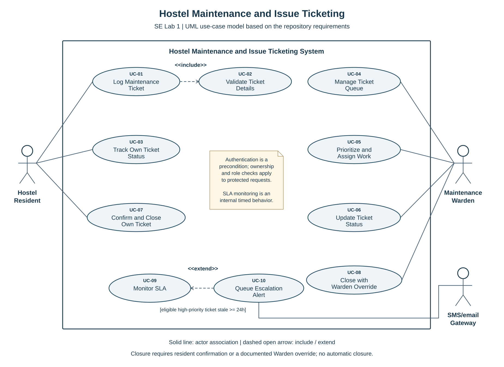

# SE Lab 1 Hostel Maintenance and Issue Ticketing

Reviewed requirements and UML submission based on the three original files
in this repository at commit `5244633b311e4cb879bc8326ee5fbbed39e81b71`.

## Completed submission

- `SE_Lab1_Hostel_Maintenance_Report.pdf`: consolidated report and digital diagram.
- `requirements.md`: five functional and two non-functional source requirements,
  including priorities, acceptance criteria, and rationale.
- `use_case_specifications.md`: ten use cases, the detailed UC-01 flow,
  alternatives, closure paths, SLA behavior, and state rules.
- `traceability.md`: requirement-to-use-case mapping and 18 proposed acceptance
  scenarios, explicitly not presented as executed tests.
- `review_notes.md`: corrections, source gaps, and design clarifications.
- `diagrams/`: editable SVG, PNG preview, and standalone printable PDF.
- `requirements.json`: structured transcription of the original requirements.
- `originals/`: the two original Word files and photographed diagram, preserved
  byte-for-byte.

## Main corrections

The digital UML uses **Maintenance Warden**, matching the written requirements;
the photograph labelled that actor Maintenance Worker. It adds a system
boundary, correct include/extend directions, explicit override closure, and
the supporting SMS/email gateway. Validation is mandatory on ticket creation;
escalation is conditional on an eligible inactivity breach. Queue viewing does
not require assigning work on every visit.

The seven original requirement IDs are retained. Added behavioral details are
labelled as clarifications, including open-ticket SLA eligibility, one alert
per inactivity episode, and the normal state-transition order.

## Source and verification limits

No Lab 1 handout/rubric was provided. This package is checked against the
repository's requirements and use-case flow. It is a documentation/design
submission, not an implemented application. Acceptance scenarios have not
been executed, and no security or performance result is claimed.

The final PDF and diagram were rendered and visually inspected. Originals
were checked against the source Git blobs. The editable SVG can be changed
directly or regenerated with `python generate_diagram.py` (standard library).

Full details and assumptions are in `review_notes.md`.
